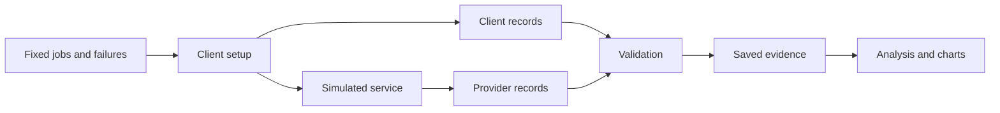

# AI Provider Outage Test

A controlled experiment on a question every team using AI services runs into: when a service fails, do the usual retry protections actually help — and what do they cost?

## Key findings

Software commonly retries failed calls. This project built a simulated AI service and tested retry protections in four scripted situations. The measurements track successful requests, waiting time, calls reaching the service and repeated work.

- **Lost replies: 90 → 0 duplicate executions per run** (repeated work).
- **Rate limiting: 1.62 → 3.02 seconds waiting time for the slowest 1% of outcomes.**
- **Outage success: 89.3% → 66.5%.**

**Sending fewer retries is not the same as serving users better. Measure successful work.** This is a simulation with three runs per setup and situation. It does not demonstrate real-provider performance or production guarantees.

[Measured results](docs/results.md) · [Chart data](docs/chart_data.json) · [Engineering log](docs/engineering-log.md) · [Reproduction instructions](#how-to-reproduce)

## What was tested

- **S0 — Healthy service:** normal operation.
- **S1 — Rate-limit burst:** temporary “too many requests” replies.
- **S2 — Outage:** service unavailable from 20 to 35 seconds in the scripted run.
- **S3 — Lost replies:** work completes but its reply is lost; retries may repeat the work.

Five setups add protections cumulatively; each includes the protections above it:

- **C0 — Baseline retries:** up to 4 calls, a 5-second per-call limit and fixed half-second waits.
- **C1 — Adds a time limit:** 6 seconds overall and 2 seconds per call.
- **C2 — Adds smarter waiting:** progressively longer, randomized retry waits, honoring the service’s retry hint.
- **C3 — Adds a circuit breaker:** temporarily stop calls after repeated failures, then let one test call through.
- **C4 — Adds job IDs:** recognize repeated requests instead of performing completed work again.

Each registered setup/situation has three runs. Results show the middle value (**median**) and [minimum, maximum] observed range, without pooling requests across runs. Healthy service tests baseline retries and full protection; the other situations test all five setups. Matching runs share fixed workload and failure seeds.

## Results

| Situation | Goal measured | C0 baseline retries | C4 full protection | Verdict |
| --- | --- | --- | --- | --- |
| S0 — Healthy service | Extra provider attempts / planned request | 0 [0, 0] | 0 [0, 0] | NO MEASURABLE EFFECT |
| S1 — Rate-limit burst | Client attempts / planned request | 1.28 [1.24, 1.28] | 1.22 [1.21, 1.26] | HARMFUL |
| S2 — Outage | Outage attempts / planned outage request | 2.78 [2.71, 2.91] | 0.12 [0.12, 0.127] | HARMFUL |
| S3 — Lost replies | Duplicate provider executions / run | 90 [82, 98] † | 0 [0, 0] | EFFECTIVE |

Values use 2–3 significant figures; † flags more than 10% relative spread. A call is an attempt to complete a request (one planned job). The “slowest 1%” waiting measure, **p99**, is the 99th-percentile time to a final outcome, including failures. Full precision remains in the [detailed results](docs/results.md). **EFFECTIVE:** the main goal improves sufficiently without a safety measure getting worse. **HARMFUL:** a safety measure got worse, even where the main goal improved. **NO MEASURABLE EFFECT:** no sufficiently large change was observed. **INCONCLUSIVE:** the evidence does not decide. Exact [registered rules](bench/thresholds.yaml) also require improvement beyond observed baseline variation; healthy service is a control, never an efficacy win.

## Chart 1 — Outage: fewer calls, more failed requests

<picture>
<source media="(prefers-color-scheme: dark)" srcset="docs/retry-storm-dark.svg">
<source media="(prefers-color-scheme: light)" srcset="docs/retry-storm-light.svg">

</picture>

Blue **C0 baseline retries** and dashed orange **C4 full protection** show calls reaching the service. Shading marks the scripted 20–35-second outage; bands show the three-run minimum and maximum, not confidence intervals. Lines represent each setup’s middle outage-call result: baseline retries round 1, full protection round 2. These are not a matched pair. Recovery summaries describe all runs, not events on those lines. Fewer calls during the outage came with more failed requests and slower recovery. Zero calls does not mean requests succeeded.

## Chart 2 — How each protection step performed

<picture>
<source media="(prefers-color-scheme: dark)" srcset="docs/protection-ladder-dark.svg">
<source media="(prefers-color-scheme: light)" srcset="docs/protection-ladder-light.svg">

</picture>

Dots show middle values; whiskers show the observed three-run ranges. Numeric axes start at zero. Each protection adds to earlier ones, so these comparisons do not isolate individual mechanisms. The top row shows the goal; the bottom row shows a safety measure that can overturn an apparent improvement. Words and icons retain the registered verdicts.

## Three practical lessons

1. **Count successful work, not just traffic.** The rate-limit burst had fewer calls but longer waits. Lost-reply protection prevented repeated work.
2. **Read the cost of failing quickly alongside the savings.** In S2 outage, C4 full protection had **200 [183, 203] fail-fast outcomes per 600 jobs**. Fail-fast means returning a failure without further retries; some jobs had already made attempts. It is not a successful fallback. Overall success fell **89.3% → 66.5%**; outside-outage success fell **100% → 88.7%**. Median recovery after the outage rose **5 → 10 seconds**, with C4 ranging 9–11 seconds. A median does not decide the safety check: round 2 took 11 seconds, exceeding its 10-second limit.
3. **Fast failure needs an alternative:** a clear error, queue or backup service. **No fallback was implemented or tested here.**

Of 7 HARMFUL comparisons between successive protection steps, 4 are MARGINAL and 3 CLEAR. MARGINAL means every failing safety check worsened by less than 5.0% after rounding relative changes to one decimal percentage point; otherwise CLEAR. These labels never change HARMFUL. The [complete comparison table](docs/results.md#verdict-strength) gives each failing check, run, values and change.

## How the experiment works



The simulated service’s record (**ledger**) separates received calls from completed executions. A retry can receive a saved reply without performing the job again. Rules were fixed before official runs; [thresholds and decision rules](bench/thresholds.yaml) define measurements and safety limits. The design has 17 registered setup/situation combinations and seeds 12001–12003; a seed controls randomized choices, not host scheduling.

## Data quality

The saved record contains **51 valid official runs**. 1 invalid attempt failed timing checks, was retained and repeated; 1 abandoned attempt was retained and excluded. There are 53 attempts and 55 official artifacts in total. A VM shutdown left an empty reservation without receipts. Its initiator is unknown. Original approval records and historical capture-time proof remain unavailable; authenticated approval history is NOT VERIFIED. The [recovery decision](docs/recovery-decision-20261105.md) and [engineering log](docs/engineering-log.md) explain the retained records, exclusions and unavailable history.

## Limitations

- Simulated service, not a real AI provider; three runs per setup/situation and limited failure profiles.
- Timing variation, shared-machine scheduling and arrival-dependent failures affect outcomes even with fixed seeds.
- Job-ID effectiveness depends on the simulated provider’s implementation.
- Execution counts describe repeated work, not monetary costs.
- No production availability, real-service exactly-once or independent unconditional approval is established.

## How to reproduce

1. **Read:** inspect [saved results](docs/results.md), [chart data](docs/chart_data.json), [registration](bench/registration.lock.json) and [official evidence](results/official/).
2. **Recompute:** use a full clone, Python 3.14 and pinned dependencies. Run `source scripts/env.sh`, verify `which python` points into the project’s `.venv`, and install binary wheels with `python -m pip install --only-binary=:all: -r requirements-dev.lock`. The report check below reads saved evidence; omit `--check` to regenerate reports and charts.
3. **New experiments:** require separate approval, fresh output paths and preservation of official files, workloads and failure schedules. See [AGENTS.md](AGENTS.md); this does not authorize a real-provider call.

## Tests

```sh
source scripts/env.sh
PYTHONPATH=src PYTHONDONTWRITEBYTECODE=1 python -m pytest -q --basetemp="$(dirname "$PWD")/.pytest-tmp-ai-provider-outage-test" tests/
PYTHONPATH=src PYTHONDONTWRITEBYTECODE=1 python -m bench.report --check
python -m pip check
```

Verification covers independent recomputation, invalid/tampered evidence, risky calls, secrets, chart freshness and repeatable rendering. Tests launch no official experiments.

## Tools and credits

Built with OpenAI Codex assistance and Python / Matplotlib; owner-supplied tools were VS Code Codex, GPT-6.1 Sol. **No AI model generated benchmark responses.** The service is scripted. The owner reviewed the previous presentation. This revision awaits owner review; AI assistance and automated checks are not a substitute for independent review. [bench/report.py](bench/report.py) generates this README; [bench/charts.py](bench/charts.py) draws the charts. Project materials use the [MIT licence](LICENSE); dependencies retain their own licences.

<details>
<summary>Glossary</summary>

**Request/job:** one planned unit of work. **Attempt/call:** one network call made for that job. **p99:** time to a final outcome at the 99th percentile, including failures. **Circuit breaker:** temporarily blocks calls after repeated failures, then permits a test call. **Backoff/jitter:** progressively longer retry waits with random variation. **Job ID/idempotency:** reuse an identifier so the service can recognize completed work. **Fail-fast:** return a failure without further retries; earlier attempts may already have occurred. **Recovery time:** time after the outage until a registered five-second window reaches 95% success; an empty window cannot qualify. **Safety check:** a limit that must pass alongside the goal measurement. **Run/setup/scenario:** one collection, a cumulative client configuration, and a scripted situation. **Valid/invalid/abandoned:** accepted evidence, evidence rejected by fixed checks, or an interrupted attempt retained but excluded. **Seed:** a fixed input controlling random choices. **Provider record/ledger:** the service’s record of received calls and actual executions. **Marginal/clear:** the size labels defined above for failing checks; neither changes a registered verdict.

</details>
