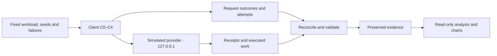

# AI Provider Outage Test

I stopped duplicate work after lost replies, but the same protection stack made my rate-limit and outage results worse. I measured both the calls reaching my simulated provider and the requests that actually succeeded.

The figures compare my baseline with the full protection stack. **p99 latency** is the 99th-percentile time to a final outcome, including failures.

**Lost replies: 90 → 0 duplicate executions per run. Rate-limit burst: 1.62 → 3.02 seconds p99 latency.**

This is a local simulation on **127.0.0.1**, not a test of a commercial AI API. One planned job is a **request**; it can make several network **attempts**. **C0** is my baseline retry policy. **C4** includes all four protections below.

[Detailed measurements](docs/results.md) · [Source data](docs/chart_data.json) · [Engineering log](docs/engineering-log.md) · [Reproduce](#reproduce-the-work)

## What I observed

A **guardrail** is a safety condition that must pass alongside a lower call count. I fixed these rules before capture; HARMFUL takes precedence when a safety check fails. The **median** is the middle of three run values; brackets show the minimum and maximum.

| Scenario | Metric and unit | C0 baseline | C4 full ladder | Registered verdict |
| --- | --- | --- | --- | --- |
| S0 | Extra provider attempts / planned request | 0 [0, 0] | 0 [0, 0] | NO MEASURABLE EFFECT |
| S1 | Client attempts / planned request | 1.28 [1.24, 1.28] | 1.22 [1.21, 1.26] | HARMFUL |
| S2 | Outage attempts / planned outage request | 2.78 [2.71, 2.91] | 0.12 [0.12, 0.127] | HARMFUL |
| S3 | Duplicate provider executions / run | 90 [82, 98] † | 0 [0, 0] | EFFECTIVE |

Values are median [minimum, maximum] across three valid runs, rounded for reading. † flags more than 10% relative spread. The detailed report retains numeric precision. S0 is a healthy control, not an efficacy win.

## Why I built it

Retries can repeat useful work after a lost reply or add pressure during a failure. I wanted to see when deadlines, randomized retry waits, temporary call rejection and reusable job keys helped—and what successful work they cost.

## How it works



I reconcile client outcomes with the provider's **ledger**, its record of received calls and executed jobs. A received retry is not necessarily new execution. The separate admin interface requires a per-run token; bodies, concurrency and run time are bounded.

## What I tested

I registered **17 cells**, with three paired runs per cell and workload/failure seeds **12001–12003**. S0 uses C0/C4; S1–S3 use C0–C4. Configurations share workload seeds and failure parameters within a round. Arrival-dependent rate limiting can still vary with timing.

| Scenario | Condition | Goal metric |
| --- | --- | --- |
| S0 | Healthy service | Extra provider attempts per planned request |
| S1 | Burst against a rate limit | Client attempts per planned request |
| S2 | Errors and hung calls during 20–35 s | Provider calls during the outage per planned outage request |
| S3 | Replies lost after work finishes | Duplicate provider executions per run |

I compare paired runs without pooling requests. An EFFECTIVE result needs at least 20% improvement, larger than the baseline's observed relative range, and every safety check passing. The [registration](bench/thresholds.yaml) defines denominators, limits and verdicts.

## The protections I added

| Configuration | Added protection | Meaning here |
| --- | --- | --- |
| C0 | Baseline retries | Up to four attempts, 5 s per attempt, fixed 0.5 s waits |
| C1 | Deadline | A 6 s total budget and at most 2 s per attempt |
| C2 | Backoff with jitter | Randomized waits; honor valid retry delays on rate-limit replies |
| C3 | Circuit breaker | Temporarily reject calls locally after enough relevant failures, then admit a probe |
| C4 | Idempotency key | Reuse a stable job key to replay a completed result without executing again |

Each step inherits earlier protections. These comparisons do not isolate a mechanism from interactions with the rest of the stack.

## What each step changed


Lines use each configuration's median registered outage-call metric run: C0 round 1 and C4 round 2. They are not a matched pair. Bands show per-second min–max across all three runs, not confidence intervals. Zero means no calls reached the provider, not that requests succeeded.

In S2, C4 had **200 [183, 203] fail-fast outcomes per 600 jobs**. Fail-fast means returning a failure without further retries; some jobs had already made attempts. It is not a successful fallback. Overall success fell **89.3% → 66.5%**; outside-outage success fell **100% → 88.7%**. Median recovery after the outage was **5 → 10 seconds**, with C4 ranging 9–11 seconds. A median does not decide the safety check: round 2 took 11 seconds, exceeding its 10-second limit.


Dots are three-run medians; whiskers show min–max. Each scenario shows its goal and decisive safety checks; axes start at zero. Words and icons identify harm [!], effectiveness [+] or no measurable effect [=]. Labels report failed paired rounds even when rounded values look equal. [All comparisons](docs/results.md#paired-decisions) retain full inputs.

## What I learned

I would reject the full stack for these S1/S2 workloads under my registered rules. S1's worse p99 latency defeats the lower attempt count. In S2, fewer calls come with fewer successful jobs and slower recovery. In S3, C4 eliminates duplicate execution in every run while preserving success.

A production caller would need an explicit fallback policy: for example, a bounded queue, a clearly signalled unavailable response or an alternate service with separate safety and cost checks. **I did not implement or test any fallback.** Fast failure alone does not supply one.

## Failures and recovery

I preserved one health-invalid S3/C2 attempt and its valid retry. A shutdown left a zero-byte reservation with no receipts. The [recovery decision](docs/recovery-decision-20261105.md) retains it as ABANDONED attempt 1 and counts later attempts against the original cap.

The complete manifest accounts for **51 VALID runs, one INVALID and one ABANDONED attempt: 53 attempts and 55 official artifacts**. Excluded attempts never enter valid statistics. The [dated engineering log](docs/engineering-log.md) records setbacks and rationale. The lost run and historical capture-time integrity proof cannot be reconstructed.

## Limits of the evidence

This is a **simulated provider on one shared machine**, with **three runs per cell and limited fault/load profiles**. Ranges are descriptive, not confidence intervals or significance tests. Host scheduling and arrival-dependent rate limits affect outcomes.

The simulator explicitly supports idempotency; that proves no real-service exactly-once guarantee. Executed work is a cost proxy, with no monetary pricing model. **These results may not transfer to real AI providers.** I claim neither production availability nor independent audit approval.

## Reproduce the work

**Inspect:** read the [report](docs/results.md), [chart data](docs/chart_data.json), [registration](bench/registration.lock.json) and [official artifacts](results/official/). No capture is needed.

**Recompute:** use a full clone and Python 3.14. Activate with `source scripts/env.sh`; verify `which python` points into this project's `.venv`. For a new environment, install locked binary wheels with `python -m pip install --only-binary=:all: -r requirements-dev.lock`. Run `PYTHONPATH=src PYTHONDONTWRITEBYTECODE=1 python -m bench.report --check` to reconcile saved evidence and verify derivatives. Omitting `--check` regenerates them without launching a provider.

**Reproduce an experiment:** first agree separate capture authorization and a fresh destination under [AGENTS.md](AGENTS.md). Preserve registered workloads, seeds and failure schedules and existing official files. These instructions do not authorize overwriting evidence or calling a real provider.

## Testing

```sh
source scripts/env.sh
PYTHONPATH=src PYTHONDONTWRITEBYTECODE=1 python -m pytest -q --basetemp=/home/sm/Projects/.pytest-tmp-ai-provider-outage-test tests/
PYTHONPATH=src PYTHONDONTWRITEBYTECODE=1 python -m bench.report --check
python -m pip check
```

Tests independently recompute metrics and decisions, check negative and tamper cases, enforce security patterns, and verify deterministic charts and freshness. These checks launch no experiments.

## Provenance, tools and licence

The manifest preserves original and recovery runner identities. Source paths, SHA256 hashes, formulas and full-precision measurements are in the chart data. [bench/report.py](bench/report.py) generates this README; [bench/charts.py](bench/charts.py) renders the charts.

I used Codex with GPT-6.1 Sol for code, analysis and documentation, plus Python and locked Matplotlib. No AI model supplied benchmark responses. AI assistance and automated checks do not replace independent review. Project materials use the [MIT licence](LICENSE); dependencies retain their own licences.

## Terms used here

A **paired round** uses matching workload/failure seeds across configurations. **Recovery** is the first registered five-second window meeting the 95% success condition, checked at whole seconds after the outage. An empty window cannot establish recovery; no qualifying observation is recorded as missing.
