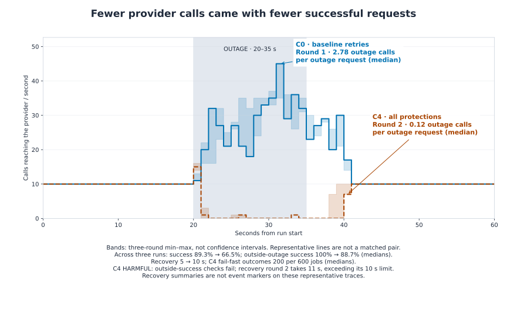
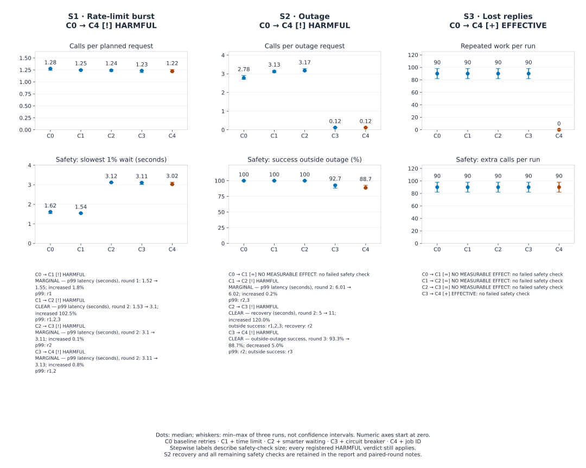
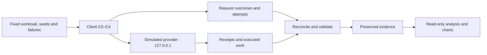

# AI Provider Outage Test

## Findings

Retry protections can prevent duplicate work while making other failures worse. In this local simulator, the full stack eliminated repeated execution after lost replies, but reduced successful work during an outage and increased delay during a rate-limit burst. Lower provider traffic alone did not establish a better service.

- **Lost replies: 90 → 0 duplicate executions per run.**
- **Rate-limit burst: 1.62 → 3.02 seconds p99 latency.**
- **Outage success: 89.3% → 66.5%.**

[Detailed measurements](docs/results.md) · [Source data](docs/chart_data.json) · [Engineering log](docs/engineering-log.md) · [Reproduce](#reproduction)

## Outage: fewer calls, more failed requests

<picture>
<source media="(prefers-color-scheme: dark)" srcset="docs/retry-storm-dark.svg">
<source media="(prefers-color-scheme: light)" srcset="docs/retry-storm-light.svg">

</picture>

Lines use each configuration's median outage-call metric run: C0 round 1 and C4 round 2. They are not a matched pair. Bands show per-second min–max across all three rounds. Zero means no calls reached the provider, not that requests succeeded. Recovery summaries describe all three runs, not events on the representative lines.

## Essential terms

**Request:** one planned job; an **attempt** is one network call made for that job.<br>
**C0:** baseline retries; **C4:** the complete, cumulative protection stack.<br>
**p99 latency:** the 99th-percentile time to a final outcome, including failures.<br>
**Median and range:** the middle run value, followed by [minimum, maximum].<br>
**Guardrail:** a safety check that must pass alongside an improved goal metric.<br>
**Recovery:** the first registered five-second window reaching 95% success after the outage; an empty window cannot qualify.

## Results across four failure conditions

| Scenario | Metric and unit | C0 baseline | C4 full ladder | Registered verdict |
| --- | --- | --- | --- | --- |
| S0 | Extra provider attempts / planned request | 0 [0, 0] | 0 [0, 0] | NO MEASURABLE EFFECT |
| S1 | Client attempts / planned request | 1.28 [1.24, 1.28] | 1.22 [1.21, 1.26] | HARMFUL |
| S2 | Outage attempts / planned outage request | 2.78 [2.71, 2.91] | 0.12 [0.12, 0.127] | HARMFUL |
| S3 | Duplicate provider executions / run | 90 [82, 98] † | 0 [0, 0] | EFFECTIVE |

S0 is healthy service; S1 is a rate-limit burst; S2 combines errors and hung calls during 20–35 seconds; S3 loses replies after work finishes. Values are median [minimum, maximum] across three VALID runs, rounded to 2–3 significant figures. † flags more than 10% relative spread. The detailed report retains full precision. S0 is a control, not an efficacy win.

## How the protection ladder performed

<picture>
<source media="(prefers-color-scheme: dark)" srcset="docs/protection-ladder-dark.svg">
<source media="(prefers-color-scheme: light)" srcset="docs/protection-ladder-light.svg">

</picture>

Dots show medians and whiskers min–max across three runs. All numeric axes start at zero. Each step inherits earlier protections; the comparisons do not isolate individual mechanisms. Words and icons identify the registered verdicts; the table below explains the size of failing checks.

## Three practical lessons

- **Judge successful work, not traffic alone.** S1's worse p99 latency defeats its lower attempt count. S3 shows the useful case: stable job keys eliminate duplicate execution while preserving success.
- **Read outage costs alongside load reduction.** In S2, C4 had **200 [183, 203] fail-fast outcomes per 600 jobs**. Fail-fast means returning a failure without further retries; some jobs had already made attempts. It is not a successful fallback. Overall success fell **89.3% → 66.5%**; outside-outage success fell **100% → 88.7%**. Median recovery after the outage was **5 → 10 seconds**, with C4 ranging 9–11 seconds. A median does not decide the safety check: round 2 took 11 seconds, exceeding its 10-second limit.
- **Fast failure needs a product decision.** A failure without further retries can protect capacity, but it is not a successful fallback. A production caller would need an explicit policy, such as a bounded queue, a clearly signalled unavailable response or an alternate service with separate safety and cost checks. **No fallback was implemented or tested.**

## Problem and architecture

A lost reply can hide completed work, so retrying may execute it twice. During service failures, retries can also add load and delay the caller. This project measures both effects using a local simulated provider on **127.0.0.1**.



Client outcomes reconcile with the provider's **ledger**, its record of received calls and executed jobs. A received retry is not necessarily a new execution. The separate admin interface requires a per-run token; bodies, concurrency and run time are bounded.

The registered design has **17 cells**, three paired runs per cell and workload/failure seeds **12001–12003**. S0 uses C0/C4; S1–S3 use C0–C4. Configurations share workload seeds and failure parameters within each round. Requests are never pooled across rounds. An EFFECTIVE result requires at least 20% improvement, larger than the baseline's observed relative range, with every safety check passing. The [registration](bench/thresholds.yaml) defines denominators, limits and verdicts.

## C0–C4 protections

| Configuration | Added protection | Meaning here |
| --- | --- | --- |
| C0 | Baseline retries | Up to four attempts, 5 s per attempt, fixed 0.5 s waits |
| C1 | Deadline | A 6 s total budget and at most 2 s per attempt |
| C2 | Backoff with jitter | Randomized waits; honor valid retry delays on rate-limit replies |
| C3 | Circuit breaker | Temporarily reject calls locally after enough relevant failures, then admit a probe |
| C4 | Idempotency key | Reuse a stable job key to replay a completed result without executing again |

## Stepwise verdict strength

| Scenario | Protection step | Registered verdict | Worst failing safety check and size |
| --- | --- | --- | --- |
| S1 | C0 → C1 | HARMFUL | MARGINAL — p99 latency (seconds), round 1: 1.52 → 1.55; increased 1.8% |
| S1 | C1 → C2 | HARMFUL | CLEAR — p99 latency (seconds), round 2: 1.53 → 3.1; increased 102.5% |
| S1 | C2 → C3 | HARMFUL | MARGINAL — p99 latency (seconds), round 2: 3.1 → 3.11; increased 0.1% |
| S1 | C3 → C4 | HARMFUL | MARGINAL — p99 latency (seconds), round 2: 3.11 → 3.13; increased 0.8% |
| S2 | C0 → C1 | NO MEASURABLE EFFECT | — |
| S2 | C1 → C2 | HARMFUL | MARGINAL — p99 latency (seconds), round 2: 6.01 → 6.02; increased 0.2% |
| S2 | C2 → C3 | HARMFUL | CLEAR — recovery (seconds), round 2: 5 → 11; increased 120.0% |
| S2 | C3 → C4 | HARMFUL | CLEAR — outside-outage success, round 3: 93.3% → 88.7%; decreased 5.0% |
| S3 | C0 → C1 | NO MEASURABLE EFFECT | — |
| S3 | C1 → C2 | NO MEASURABLE EFFECT | — |
| S3 | C2 → C3 | NO MEASURABLE EFFECT | — |
| S3 | C3 → C4 | EFFECTIVE | — |

MARGINAL means every failing safety check worsened by less than 5.0% after rounding its relative change to one decimal percentage point; otherwise CLEAR. The worst failing paired-round check is shown. A relative decrease in success is not a percentage-point decrease. These descriptions do not change HARMFUL or any registered threshold. EFFECTIVE, NO MEASURABLE EFFECT and INCONCLUSIVE retain their registered meanings.

## Failures and recovery

One health-invalid S3/C2 attempt and its valid retry remain preserved. A shutdown left a zero-byte reservation with no receipts. The [recovery decision](docs/recovery-decision-20261105.md) retains it as ABANDONED attempt 1 and counts later attempts against the original cap. The shutdown initiator remains unknown; the owner states, “I did not shut down the VM.” Original registration/recovery approval locations and original G1/G7 decision records are unavailable; authenticated approval history is **NOT VERIFIED**.

The complete manifest accounts for **51 VALID runs, 1 INVALID and 1 ABANDONED attempt: 53 attempts and 55 official artifacts**. Excluded attempts never enter valid statistics. The [dated engineering log](docs/engineering-log.md) preserves setbacks and retrospective rationale. The lost run and historical capture-time integrity proof cannot be reconstructed.

## Limitations

This is a **simulated provider on one shared machine**, with **three runs per cell and limited fault/load profiles**. Ranges are descriptive, not confidence intervals or significance tests. Host scheduling and arrival-dependent rate limits affect outcomes even with seeded policies.

The simulator explicitly supports idempotency; that proves no real-service exactly-once guarantee. Executed work is a cost proxy, with no monetary pricing model. **These results may not transfer to real AI providers.** They establish neither production availability nor independent audit approval.

## Reproduction

1. **Inspect:** read the [report](docs/results.md), [chart data](docs/chart_data.json), [registration](bench/registration.lock.json) and [official artifacts](results/official/). No capture is needed.
2. **Recompute:** use a full clone and Python 3.14. Run `source scripts/env.sh`; verify `which python` points into this project's `.venv`. Install locked binary wheels with `python -m pip install --only-binary=:all: -r requirements-dev.lock`. Run `PYTHONPATH=src PYTHONDONTWRITEBYTECODE=1 python -m bench.report --check` to reconcile saved evidence and verify derivatives. Omitting `--check` regenerates them without launching a provider.
3. **Reproduce an experiment:** agree separate capture authorization and a fresh destination under [AGENTS.md](AGENTS.md). Preserve registered workloads, seeds, failure schedules and existing official files. These instructions do not authorize overwriting evidence or calling a real provider.

## Testing, tools and provenance

```sh
source scripts/env.sh
PYTHONPATH=src PYTHONDONTWRITEBYTECODE=1 python -m pytest -q --basetemp=/home/sm/Projects/.pytest-tmp-ai-provider-outage-test tests/
PYTHONPATH=src PYTHONDONTWRITEBYTECODE=1 python -m bench.report --check
python -m pip check
```

Tests independently recompute metrics and decisions, check negative and tamper cases, enforce security patterns, and verify deterministic charts and freshness. These checks launch no experiments.

The manifest preserves original and recovery runner identities. Source paths, SHA-256 hashes, formulas and full-precision measurements are in the chart data. [bench/report.py](bench/report.py) generates this README; [bench/charts.py](bench/charts.py) renders the charts.

Tools: **VS Code Codex, GPT-6.1 Sol**, Python and locked Matplotlib. **No AI model generated benchmark responses.** AI assistance and automated checks do not replace independent review. Project materials use the [MIT licence](LICENSE); dependencies retain their own licences.
