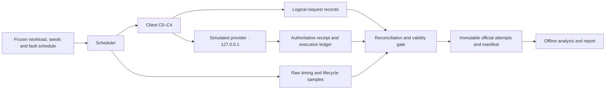

# AI Provider Outage Test

**Deadlines, retry backoff, circuit breaking and idempotency — measured against a frozen local fault workload.**

I built a simulated provider to test a practical question: when does a more defensive client actually help? The full protection ladder eliminated duplicate executions after lost replies, but it was **HARMFUL** under the registered rate-limit and outage workloads. Fewer calls reached the provider; that alone did not make the client better.

**Lost replies: 90 → 0 duplicate executions per run. Rate-limit burst: 1.615 → 3.025 seconds p99 latency.**

[Measured report](docs/results.md) · [Engineering log](docs/engineering-log.md) · [Source data](docs/chart_data.json) · [Reproduce](#reproduce-the-work)


The grey region is the registered outage, **[20, 35) seconds**. Blue is C0; dashed orange is C4. Each line represents its configuration's median primary-metric run; ties use the earliest round. Bands show per-second min–max across three runs, not confidence intervals. Representatives may use different rounds; decisions use all three paired rounds.

## Measured results

| Scenario | Metric and unit | C0 baseline | C4 full ladder | Registered verdict |
| --- | --- | --- | --- | --- |
| S0 | Extra provider attempts / planned request | 0 [0, 0] | 0 [0, 0] | NO MEASURABLE EFFECT |
| S1 | Client attempts / planned request | 1.27727 [1.24091, 1.27727] | 1.22045 [1.21364, 1.25909] | HARMFUL |
| S2 | Outage attempts / planned outage request | 2.78 [2.70667, 2.91333] | 0.12 [0.12, 0.126667] | HARMFUL |
| S3 | Duplicate provider executions / run | 90 [82, 98] † | 0 [0, 0] | EFFECTIVE |

C0 is the baseline; C4 includes all four protections. Values are **median [min, max] across three VALID runs per cell**, computed per run before aggregation. † marks >10% relative spread. The table uses each scenario's frozen primary metric; an EFFECTIVE verdict also requires every applicable guardrail to pass.

In S1, C0/C4 median p99 request latency is 1.615/3.025 seconds. In S2, success outside the outage is 100.00%/88.67%; median recovery is 5/10 seconds after the outage ends. These costs matter even when fewer calls reach the provider. A p99 is the 99th-percentile time to a final request outcome; failed requests count too.

I retained these losses in the headline results. The registered rules give harm precedence over an apparent improvement. [All 17 cells and paired guardrails](docs/results.md#paired-decisions) remain available, including intermediate configurations.

## The problem I tested

Retrying a failed request can help one caller while adding pressure to a struggling service. A different problem occurs when work finishes but its reply disappears: retrying can execute the same job twice.

I used synthetic text jobs and scripted failures to separate those cases. Every request stays on **loopback (`127.0.0.1`)**. No real AI provider supplies responses, and these measurements make no claim about a commercial API.

## Architecture



The ledger records what reached the provider and what executed. Logical records capture the caller's final outcome, including failures. I reconcile the two before calculating results. The provider exposes a separate loopback admin interface protected by a per-run token; request bodies, concurrency and run time are bounded.

## Frozen experiment

I froze the [scenario design](bench/scenarios.yaml), [decision rules](bench/thresholds.yaml) and [registration hashes](bench/registration.lock.json) before official capture. The design has **17 cells**, three paired rounds and seeds **12001–12003**. S0 tests C0/C4; S1–S3 test C0–C4.

| Scenario | Scripted condition | Registered primary metric |
| --- | --- | --- |
| S0 · healthy control | Normal service | Extra provider attempts per planned request |
| S1 · rate-limit burst | Burst against a token bucket | Client attempts per planned request |
| S2 · outage | Errors and hung calls during [20, 35) s | Outage provider attempts per planned outage request |
| S3 · lost replies | Some replies disappear after execution | Duplicate provider executions |

The same workload seeds and failure parameters apply to each configuration in a round. Arrival-dependent rate limiting still varies with timing. I use nearest-rank latency percentiles, preserve paired guardrails and never pool requests across runs. A measured improvement needs to be at least 20% and exceed the baseline's relative range, with all guardrails passing. S0 is a control, not an efficacy win.

## The protection ladder

| Configuration | Added protection | Concrete policy |
| --- | --- | --- |
| C0 | Baseline retries | At most four attempts; 5 s attempt timeout; fixed 0.5 s retry wait |
| C1 | Deadlines | 6 s total budget; at most 2 s per attempt |
| C2 | Backoff with jitter | Randomized retry waits; honor valid Retry-After on rate-limit replies |
| C3 | Circuit breaker | Temporarily reject local calls after enough failures, then admit a probe |
| C4 | Idempotency keys | Reuse a stable job key so the simulator can replay completed work |

Each step inherits the earlier protections. The [frozen client semantics](bench/thresholds.yaml) specify retry eligibility, boundary conditions and breaker transitions. These are cumulative comparisons; they do not isolate a mechanism's effect from every interaction.

## Mechanism-by-mechanism results

| Scenario | C0 reference: primary median [min, max] | C1 vs C0 | C2 vs C1 | C3 vs C2 | C4 vs C3* |
| --- | --- | --- | --- | --- | --- |
| S0 | 0 [0, 0] | not registered | not registered | not registered | NO MEASURABLE EFFECT |
| S1 | 1.27727 [1.24091, 1.27727] | HARMFUL | HARMFUL | HARMFUL | HARMFUL |
| S2 | 2.78 [2.70667, 2.91333] | NO MEASURABLE EFFECT | HARMFUL | HARMFUL | HARMFUL |
| S3 | 90 [82, 98] † | NO MEASURABLE EFFECT | NO MEASURABLE EFFECT | NO MEASURABLE EFFECT | EFFECTIVE |

*S0 C4 compares directly with C0; C1–C3 were not registered there. C0 is a reference, not a verdict. The [full report](docs/results.md#paired-decisions) also compares each registered candidate directly with C0. Only EFFECTIVE, NO MEASURABLE EFFECT, HARMFUL and INCONCLUSIVE are allowed.

## What I learned

**I would reject the full ladder for these S1/S2 workloads under the registered criteria.** S1's lower attempt count came with worse tail latency. In S2, suppressing traffic also suppressed useful requests outside the outage. The median recovery time alone hides a paired-round guardrail failure.

**I needed to count executions separately from retries.** In S3, idempotency removed duplicate work while retries still occurred. A successful final response does not establish that a job executed only once.

**I needed guardrails before seeing the outcome.** The outage chart makes C4's lower traffic look attractive. The paired success and recovery checks explain why that result is still HARMFUL. I report that tradeoff rather than treating quieter traffic as success.

## Failures and recovery

One S3/C2 attempt exceeded the frozen timing-health limits. I preserved it as INVALID and excluded it from statistics before its valid retry. The original batch also stopped during a shutdown, leaving slot 30's empty reservation without receipts.

The owner approved a narrow [recovery exception](docs/recovery-decision-20261105.md): retain the original reservation as ABANDONED attempt 1, preserve all completed records, and count later attempts against the existing cap. The final COMPLETE manifest accounts for **51 VALID runs, one INVALID and one ABANDONED attempt: 53 attempts and 55 official artifacts**. Neither excluded attempt is hidden or counted as a successful run.

The [engineering log](docs/engineering-log.md) also records rendering, CI and fresh-checkout metadata failures. The empty reservation cannot reconstruct the lost execution, and current hashes cannot prove historical immutability without a capture-time anchor.

## Limits of the evidence

This is a **simulated provider, on loopback, on one shared machine**, with **only three runs per cell and limited fault/load profiles**. There is **no guarantee these results transfer to real AI providers**. Three seeds and their ranges describe these observations; they are neither confidence intervals nor a significance test.

Host scheduling affects timings and arrival-dependent faults. Idempotency works because this simulator explicitly implements it; that establishes no exactly-once guarantee for another service. Executed work units are a simulated cost proxy, with no registered monetary price model. I have not claimed production availability, real-provider savings or independent audit approval.

## Reproduce the work

### Inspect the evidence

Read the [measured report](docs/results.md), [traceable chart data](docs/chart_data.json), [frozen registration](bench/registration.lock.json) and [official artifacts](results/official/). The chart data records source paths, SHA256 hashes, formulas and per-round values. This level needs no benchmark execution.

### Regenerate the report

Use a full clone and the project's Python 3.14 environment. Run `source scripts/env.sh`, then confirm `which python` points to this project's `.venv/bin/python`. For a new environment, install the pinned binary wheels with `python -m pip install --only-binary=:all: -r requirements-dev.lock`.

Run `PYTHONPATH=src PYTHONDONTWRITEBYTECODE=1 python -m bench.report --check` to verify saved outputs. Omit `--check` to regenerate the README, report, chart data and SVG from saved evidence. Neither command launches a provider.

### Reproduce an experiment

Fresh experimental capture needs separate authorization under [AGENTS.md](AGENTS.md), an agreed destination and the registered workload, seeds, policies and health gates. Existing official files must stay immutable; rerunning the official command in this checkout is not a clean replication. I have not rerun experiments for this case-study rewrite. Use the offline tests below to check implementation behavior without a capture.

## Testing

```sh
source scripts/env.sh
PYTHONPATH=src PYTHONDONTWRITEBYTECODE=1 python -m pytest -q --basetemp="$(dirname "$PROJECT_ROOT")/.pytest-tmp-ai-provider-outage-test" tests/
PYTHONPATH=src PYTHONDONTWRITEBYTECODE=1 python -m bench.report --check
python -m pip check
```

Tests independently recompute raw metrics and decisions, exercise harmful controls and zero denominators, reject tampered evidence and provenance, check recovery boundaries, and verify report/README freshness plus byte-identical chart rerenders. CI runs the offline suite and a separate freshness check. No experiment capture is part of those checks.

## Provenance, tools and licence

Official capture retains both the original runner identity and the approved recovery runner identity; the manifest and recovery sidecar link every attempt. Analysis recomputes from saved logical records and provider ledgers before rendering. This README is generated by [bench/report.py](bench/report.py); its source hash is recorded in the chart data.

I used Codex with GPT-6.1 Sol for code, analysis and documentation under owner instructions. Python and the already locked Matplotlib produce the report and chart. No AI model generated benchmark responses. Automated tests and AI assistance do not replace independent review.

Code and project materials are provided under the [MIT licence](LICENSE). Dependency licences remain those of their respective projects.

## Technical glossary

| Term | Meaning in this study |
| --- | --- |
| Logical request | One planned job, which may make several HTTP attempts or be rejected locally |
| Attempt | One physical client call; reconciled with a provider receipt |
| Amplification | Registered attempt count divided by the relevant planned-request count |
| p99 latency | Nearest-rank 99th-percentile time to a final outcome, including failures |
| Guardrail | A condition that must pass alongside a lower primary metric |
| Recovery | In S2, the first registered trailing window meeting the success threshold; details are in the report |
| Idempotency | Replaying a completed job's result instead of executing its work again |
