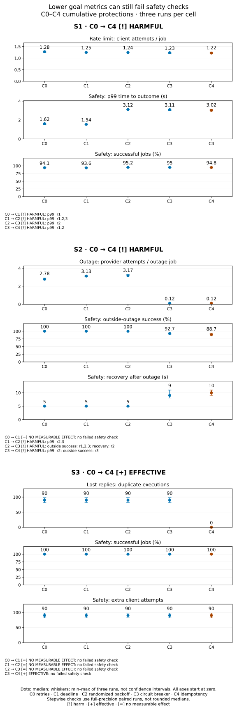
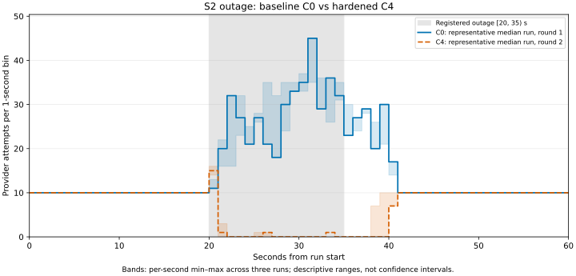

# G9: official simulator results

I measured successful requests as well as calls reaching a local simulated provider. Fewer calls can mean failed requests. The registered safety checks therefore decide whether a protection helped: C4 is HARMFUL in S1/S2 and EFFECTIVE in S3. These are three-run simulator observations, not real-provider guarantees.

[Outage timeline](retry-storm.svg) · [S1–S3 goals and safety checks](mechanism-ladder.svg) · [Readable case study](../README.md). Technical tables retain unrounded numeric values; [chart_data.json](chart_data.json) preserves per-run values, input hashes, formulas and verdicts.

- **S0: NO MEASURABLE EFFECT.** C0 0.0 [0.0, 0.0] → C4 0.0 [0.0, 0.0] extra provider attempts per planned request. All registered guardrails pass.
- **S1: HARMFUL.** C0 1.2772727272727273 [1.240909090909091, 1.2772727272727273] → C4 1.2204545454545455 [1.2136363636363636, 1.259090909090909] attempts per planned request. Failed guardrails: 99th-percentile request latency.
- **S2: HARMFUL.** C0 2.78 [2.7066666666666666, 2.9133333333333336] → C4 0.12 [0.12, 0.12666666666666668] outage attempts per planned outage request. Failed guardrails: recovery time, success outside the outage.
- **S3: EFFECTIVE.** C0 90 [82, 98] † → C4 0 [0, 0] duplicate provider executions. All registered guardrails pass.

In S1, C0/C4 median p99 request latency is 1.615/3.025 seconds. In S2, success outside the outage is 100.00%/88.67%; median recovery is 5/10 seconds after the outage ends. These costs matter even when fewer calls reach the provider. A p99 is the 99th-percentile time to a final request outcome; failed requests count too.

## Reading the measurements

Each entry is median [minimum, maximum] of three VALID per-run metrics; no pooling. † flags relative spread >10%; a zero median with a nonzero range is also flagged. Ranges describe these three seeds and host scheduling, not confidence intervals or isolated environmental noise. Small n=3 limits precision. Full precision, per-round values, source paths/SHA-256 hashes and formulas are in [chart_data.json](chart_data.json).

## Per-cell measurements

Success is a fraction of all planned jobs (440 in S1, 600 otherwise). Latencies include failures and are seconds. Each scenario's primary metric and units are frozen in `bench/thresholds.yaml`.

| Cell | Registered primary | Success fraction | p50 s | p95 s | p99 s |
| --- | --- | --- | --- | --- | --- |
| S0/C0 | 0.0 [0.0, 0.0] | 1.0 [1.0, 1.0] | 0.09205545000040738 [0.0914056909976324, 0.09787308699815256] | 0.10871351699970688 [0.10110049699724222, 0.11245526099992276] † | 0.11475479899818453 [0.10535287999664433, 0.11722357400030958] † |
| S0/C4 | 0.0 [0.0, 0.0] | 1.0 [1.0, 1.0] | 0.0909203369994458 [0.09084790100023454, 0.09317060800003674] | 0.1046766650002624 [0.10133442299993511, 0.11024607900017003] | 0.10846537100023568 [0.10481145499797861, 0.11574477699942065] † |
| S1/C0 | 1.2772727272727273 [1.240909090909091, 1.2772727272727273] | 0.9409090909090909 [0.9386363636363636, 0.9409090909090909] | 0.09616200766928751 [0.0918514733323974, 0.09686777600018104] | 1.5200162942859876 [1.5143788772833702, 1.5203000505742779] | 1.6150581025720925 [1.5236279162849584, 1.615891747145465] |
| S1/C1 | 1.2454545454545454 [1.2431818181818182, 1.2568181818181818] | 0.9363636363636364 [0.9363636363636364, 0.9386363636363636] | 0.09668123585678146 [0.09260044100119558, 0.09907378366430919] | 1.5171329902854538 [1.511766063000323, 1.5200572191403943] | 1.5433402660000866 [1.5328758675703824, 1.5511503894296226] |
| S1/C2 | 1.240909090909091 [1.2204545454545455, 1.2568181818181818] | 0.9522727272727273 [0.9477272727272728, 0.9545454545454546] | 0.09320640166667005 [0.09307768700091401, 0.0941974346666683] | 3.016823536569845 [3.0103919882853276, 3.0270580019996487] | 3.119496269285655 [3.104086965285596, 3.1226648658569367] |
| S1/C3 | 1.2340909090909091 [1.1954545454545455, 1.2340909090909091] | 0.95 [0.9454545454545454, 0.9522727272727273] | 0.09338811914286893 [0.08969012800116616, 0.09487582233244751] | 3.015523153999311 [3.0083912182866968, 3.0166132878569307] | 3.1073466462834674 [3.0146867600014957, 3.11510789928564] |
| S1/C4 | 1.2204545454545455 [1.2136363636363636, 1.259090909090909] | 0.9477272727272728 [0.9477272727272728, 0.9545454545454546] | 0.09219403714243057 [0.09129817285728237, 0.09741170266594423] | 3.0120566082854836 [3.0112316632852796, 3.0203931698563657] | 3.0248971625722874 [3.021714014285344, 3.1319440279994524] |
| S2/C0 | 2.78 [2.7066666666666666, 2.9133333333333336] | 0.8933333333333333 [0.8883333333333333, 0.8966666666666666] | 0.09791232700008834 [0.09410560200067408, 0.10097862100010246] | 11.127188294000554 [11.09876227999921, 11.133497193999936] | 16.63755147200045 [16.601917107001647, 16.657498397999007] |
| S2/C1 | 3.1266666666666665 [3.066666666666667, 3.16] | 0.805 [0.8, 0.8116666666666666] | 0.09628174799981792 [0.09404784700091184, 0.09937609000189696] | 6.004249543999869 [6.00418359200048, 6.005118333001882] | 6.007473858003504 [6.006724126001792, 6.021063609000159] |
| S2/C2 | 3.1733333333333333 [3.1466666666666665, 3.28] | 0.8 [0.7933333333333333, 0.8] | 0.09610282000103343 [0.09438743699956831, 0.09975881399986974] | 6.005815056999744 [6.004195588000947, 6.008134634999443] | 6.021392974999618 [6.006488612000975, 6.02167371199921] |
| S2/C3 | 0.12 [0.12, 0.12666666666666668] | 0.695 [0.6616666666666666, 0.7] | 0.08733378599972497 [0.08706029000004634, 0.09074043099899143] | 0.10617501300075638 [0.10108052399918677, 0.11092408900003647] | 2.002681002999452 [2.002373134999651, 2.005778727000507] |
| S2/C4 | 0.12 [0.12, 0.12666666666666668] | 0.665 [0.6616666666666666, 0.695] | 0.0877767499991009 [0.08451596399991068, 0.09114467100007317] | 0.10693458699861402 [0.10532160000002477, 0.11117353499994209] | 2.001779719999469 [2.0016045289998132, 2.0036881210020496] |
| S3/C0 | 90 [82, 98] † | 1.0 [1.0, 1.0] | 0.09256385099943287 [0.09187023399954342, 0.09612706099869683] | 0.6903338989994126 [0.6862569680008157, 0.6943865300017933] | 0.7005243970008479 [0.6927560259988255, 0.7020455460000434] |
| S3/C1 | 90 [82, 98] † | 1.0 [1.0, 1.0] | 0.0935833109993851 [0.0930926519991786, 0.09871456300315984] | 0.690673433999109 [0.6884415839987916, 0.6969097670014897] | 0.7032076310024422 [0.6943868809998097, 0.7096195069992977] |
| S3/C2 | 90 [82, 98] † | 1.0 [1.0, 1.0] | 0.09261415600012679 [0.09112089200007034, 0.09625151700092793] | 0.3582975249995801 [0.34947399199991214, 0.37432296299884626] | 0.4159779459980193 [0.40765517099953286, 0.42565414999990026] |
| S3/C3 | 90 [82, 98] † | 1.0 [1.0, 1.0] | 0.09555357000044751 [0.09460885400258157, 0.09786733900036637] | 0.36686113000250486 [0.35519761100058567, 0.3681911799998492] | 0.4160774990001297 [0.4160095639999781, 0.4254346350004212] |
| S3/C4 | 0 [0, 0] | 1.0 [1.0, 1.0] | 0.09592758600028617 [0.09435659999726376, 0.09625190399965433] | 0.2781134119997688 [0.27377476099991327, 0.28665951199873163] | 0.3317395289974243 [0.3296555780007111, 0.3472656629995967] |

| Cell | Attempts/request | Extra attempts | Duplicate executions | Executed work units | Loop p99 s | Launch p99 s |
| --- | --- | --- | --- | --- | --- | --- |
| S0/C0 | 1.0 [1.0, 1.0] | 0 [0, 0] | 0 [0, 0] | 600 [600, 600] | 0.010790987998916535 [0.00547911700050463, 0.025264074000006076] † | 0.008486029000053463 [0.004739526999763655, 0.025403563000324425] † |
| S0/C4 | 1.0 [1.0, 1.0] | 0 [0, 0] | 0 [0, 0] | 600 [600, 600] | 0.007249168000271311 [0.006938194001122611, 0.024786085999949137] † | 0.006654775000058066 [0.005793836999508528, 0.025725912999767786] † |
| S1/C0 | 1.2772727272727273 [1.240909090909091, 1.2772727272727273] | 122 [106, 122] † | 0 [0, 0] | 414 [413, 414] | 0.009313904996815836 [0.005633776996546658, 0.025926756000444584] † | 0.006980034002481261 [0.004785219664578122, 0.02532263100056298] † |
| S1/C1 | 1.2454545454545454 [1.2431818181818182, 1.2568181818181818] | 108 [107, 113] | 0 [0, 0] | 412 [412, 413] | 0.02521399599936558 [0.011061191999033326, 0.026112287000614742] † | 0.024690645714663617 [0.01041874166427803, 0.025057051143189568] † |
| S1/C2 | 1.240909090909091 [1.2204545454545455, 1.2568181818181818] | 106 [97, 113] † | 0 [0, 0] | 419 [417, 420] | 0.026150524001423037 [0.008375654000701616, 0.026564658000097552] † | 0.02578787585688147 [0.00684970442775068, 0.02670347799994488] † |
| S1/C3 | 1.2340909090909091 [1.1954545454545455, 1.2340909090909091] | 103 [86, 103] † | 0 [0, 0] | 418 [416, 419] | 0.02113094099877344 [0.008835509997879853, 0.024898338000639342] † | 0.018165189333861465 [0.0067316120002942625, 0.023480421666742246] † |
| S1/C4 | 1.2204545454545455 [1.2136363636363636, 1.259090909090909] | 97 [94, 114] † | 0 [0, 0] | 417 [417, 420] | 0.00655228900086513 [0.005903268000110984, 0.02655504300037137] † | 0.0054098376664715175 [0.005400293571128145, 0.026793393570965662] † |
| S2/C0 | 1.5883333333333334 [1.5733333333333333, 1.6166666666666667] | 353 [344, 370] | 0 [0, 0] | 536 [533, 538] | 0.021630805999848235 [0.009039284999744268, 0.02651959900140355] † | 0.020937620000587742 [0.007230904999595111, 0.026096073998999714] † |
| S2/C1 | 1.5816666666666668 [1.5783333333333334, 1.595] | 349 [347, 357] | 0 [0, 0] | 483 [480, 487] | 0.009918266998283798 [0.006984204999753274, 0.022018266999111802] † | 0.008774936002012623 [0.005196128001990985, 0.021733320000020484] † |
| S2/C2 | 1.5933333333333333 [1.5866666666666667, 1.6133333333333333] | 356 [352, 368] | 0 [0, 0] | 480 [476, 480] | 0.021686683000552875 [0.006081329000153346, 0.026418703999297577] † | 0.021660763999534538 [0.005773560000671196, 0.025318723000054888] † |
| S2/C3 | 0.7266666666666667 [0.6916666666666667, 0.73] | 6 [5, 7] † | 0 [0, 0] | 417 [397, 420] | 0.008302646998345153 [0.005292189998726826, 0.024621524999929534] † | 0.008107937999010773 [0.0043182849993144146, 0.023870921000707312] † |
| S2/C4 | 0.695 [0.6916666666666667, 0.7266666666666667] | 6 [5, 7] † | 0 [0, 0] | 399 [397, 417] | 0.022262619999310118 [0.008694457999808947, 0.024990185999740788] † | 0.022122483999191894 [0.006913400000485126, 0.02457329799999286] † |
| S3/C0 | 1.15 [1.1366666666666667, 1.1633333333333333] | 90 [82, 98] † | 90 [82, 98] † | 690 [682, 698] | 0.009085963996767532 [0.005807865003589541, 0.021543199000007007] † | 0.008533201998943696 [0.005380824999156264, 0.021819325999240746] † |
| S3/C1 | 1.15 [1.1366666666666667, 1.1633333333333333] | 90 [82, 98] † | 90 [82, 98] † | 690 [682, 698] | 0.01047540699801175 [0.006378024998412002, 0.021866760002012597] † | 0.008152145001801614 [0.005706325000936374, 0.021132672000021557] † |
| S3/C2 | 1.15 [1.1366666666666667, 1.1633333333333333] | 90 [82, 98] † | 90 [82, 98] † | 690 [682, 698] | 0.021733464000135427 [0.009145052998064784, 0.024835713999891595] † | 0.021766055999613343 [0.008322021000640945, 0.026160317000176292] † |
| S3/C3 | 1.15 [1.1366666666666667, 1.1633333333333333] | 90 [82, 98] † | 90 [82, 98] † | 690 [682, 698] | 0.008951891999458894 [0.008659819995955331, 0.025371480999638152] † | 0.008299177001752867 [0.00783891100072509, 0.02472388000023784] † |
| S3/C4 | 1.15 [1.1366666666666667, 1.1633333333333333] | 90 [82, 98] † | 0 [0, 0] | 600 [600, 600] | 0.02603916800035222 [0.007359212999290321, 0.026325877999624936] † | 0.025762118000059786 [0.005965452000239679, 0.025788411000760902] † |

Executed work units count actual provider executions, a simulated cost proxy only; deduplicated replies are not executions. No price or money estimate is registered. S0 extras use per-job authoritative receipts, including zero-receipt jobs.

| S2 cell | Outside-outage success fraction | Recovery s after outage end |
| --- | --- | --- |
| S2/C0 | 1.0 [1.0, 1.0] | 5 [5, 5] |
| S2/C1 | 1.0 [1.0, 1.0] | 5 [5, 5] |
| S2/C2 | 1.0 [1.0, 1.0] | 5 [5, 5] |
| S2/C3 | 0.9266666666666666 [0.8822222222222222, 0.9333333333333333] | 9 [8, 11] † |
| S2/C4 | 0.8866666666666667 [0.8822222222222222, 0.9266666666666666] | 10 [9, 11] † |

| S1 cell | Burst arrivals / 140 planned burst jobs |
| --- | --- |
| S1/C0 | 1.7428571428571429 [1.6714285714285715, 1.7571428571428571] |
| S1/C1 | 1.7 [1.6928571428571428, 1.7] |
| S1/C2 | 1.542857142857143 [1.5285714285714285, 1.5714285714285714] |
| S1/C3 | 1.5571428571428572 [1.4928571428571429, 1.5642857142857143] |
| S1/C4 | 1.5357142857142858 [1.5142857142857142, 1.6] |

| Cell | Nonzero final outcome counts: median [min, max] |
| --- | --- |
| S0/C0 | SUCCESS: 600 [600, 600] |
| S0/C4 | SUCCESS: 600 [600, 600] |
| S1/C0 | FAILED_AFTER_RETRIES: 26 [26, 27]; SUCCESS: 414 [413, 414] |
| S1/C1 | FAILED_AFTER_RETRIES: 28 [27, 28]; SUCCESS: 412 [412, 413] |
| S1/C2 | FAILED_AFTER_RETRIES: 21 [20, 23] †; SUCCESS: 419 [417, 420] |
| S1/C3 | FAILED_AFTER_RETRIES: 22 [21, 24] †; SUCCESS: 418 [416, 419] |
| S1/C4 | FAILED_AFTER_RETRIES: 23 [20, 23] †; SUCCESS: 417 [417, 420] |
| S2/C0 | FAILED_AFTER_RETRIES: 64 [62, 67]; SUCCESS: 536 [533, 538] |
| S2/C1 | DEADLINE_EXCEEDED: 51 [50, 56] †; FAILED_AFTER_RETRIES: 64 [62, 67]; SUCCESS: 483 [480, 487] |
| S2/C2 | DEADLINE_EXCEEDED: 55 [53, 56]; FAILED_AFTER_RETRIES: 65 [64, 71] †; SUCCESS: 480 [476, 480] |
| S2/C3 | FAILED_AFTER_RETRIES: 0 [0, 1] †; FAILED_FAST: 183 [179, 203] †; SUCCESS: 417 [397, 420] |
| S2/C4 | FAILED_AFTER_RETRIES: 0 [0, 1] †; FAILED_FAST: 200 [183, 203]; SUCCESS: 399 [397, 417] |
| S3/C0 | SUCCESS: 600 [600, 600] |
| S3/C1 | SUCCESS: 600 [600, 600] |
| S3/C2 | SUCCESS: 600 [600, 600] |
| S3/C3 | SUCCESS: 600 [600, 600] |
| S3/C4 | SUCCESS: 600 [600, 600] |

## Paired decisions

B=median(baseline), C=median(candidate), I=(B−C)/B, S=(max(baseline)−min(baseline))/B. Efficacy requires I≥20% and I>S with every registered guardrail passing; harm takes precedence. B=0 makes I and S null and uses raw values. S0 is a healthy control, never an efficacy win. S3 C4 also requires zero duplicates in every C4 run and positive paired C0 duplicates. Guardrails compare the same round/seed; only S0 latency compares the three-run p99 medians. All guardrail inputs, limits and pass/false/null results appear in chart_data.json.

| Scenario | Role | Pair | Verdict | I | S | Failed guardrails (round) |
| --- | --- | --- | --- | --- | --- | --- |
| S0 | primary | C0:C4 | NO MEASURABLE EFFECT | null | null | none |
| S1 | primary | C0:C4 | HARMFUL | 0.0444839857651246 | 0.028469750889679724 | latency_p99_seconds (1); latency_p99_seconds (2); latency_p99_seconds (3) |
| S1 | secondary | C0:C1 | HARMFUL | 0.024911032028469865 | 0.028469750889679724 | latency_p99_seconds (1) |
| S1 | secondary | C0:C2 | HARMFUL | 0.028469750889679724 | 0.028469750889679724 | latency_p99_seconds (1); latency_p99_seconds (2); latency_p99_seconds (3) |
| S1 | secondary | C0:C3 | HARMFUL | 0.033807829181494685 | 0.028469750889679724 | latency_p99_seconds (1); latency_p99_seconds (2); latency_p99_seconds (3) |
| S1 | stepwise | C0:C1 | HARMFUL | 0.024911032028469865 | 0.028469750889679724 | latency_p99_seconds (1) |
| S1 | stepwise | C1:C2 | HARMFUL | 0.0036496350364962405 | 0.010948905109489078 | latency_p99_seconds (1); latency_p99_seconds (2); latency_p99_seconds (3) |
| S1 | stepwise | C2:C3 | HARMFUL | 0.005494505494505507 | 0.02930402930402931 | latency_p99_seconds (2) |
| S1 | stepwise | C3:C4 | HARMFUL | 0.011049723756906103 | 0.031307550644567174 | latency_p99_seconds (1); latency_p99_seconds (2) |
| S2 | primary | C0:C4 | HARMFUL | 0.9568345323741007 | 0.07434052757793777 | outside_outage_success_fraction (1); outside_outage_success_fraction (2); recovery_seconds (2); outside_outage_success_fraction (3) |
| S2 | secondary | C0:C1 | NO MEASURABLE EFFECT | -0.12470023980815349 | 0.07434052757793777 | none |
| S2 | secondary | C0:C2 | NO MEASURABLE EFFECT | -0.14148681055155884 | 0.07434052757793777 | none |
| S2 | secondary | C0:C3 | HARMFUL | 0.9568345323741007 | 0.07434052757793777 | outside_outage_success_fraction (1); outside_outage_success_fraction (2); recovery_seconds (2); outside_outage_success_fraction (3) |
| S2 | stepwise | C0:C1 | NO MEASURABLE EFFECT | -0.12470023980815349 | 0.07434052757793777 | none |
| S2 | stepwise | C1:C2 | HARMFUL | -0.01492537313432842 | 0.0298507462686567 | latency_p99_seconds (2); latency_p99_seconds (3) |
| S2 | stepwise | C2:C3 | HARMFUL | 0.9621848739495797 | 0.042016806722689065 | outside_outage_success_fraction (1); outside_outage_success_fraction (2); recovery_seconds (2); outside_outage_success_fraction (3) |
| S2 | stepwise | C3:C4 | HARMFUL | 0.0 | 0.055555555555555684 | latency_p99_seconds (2); outside_outage_success_fraction (3) |
| S3 | primary | C0:C4 | EFFECTIVE | 1.0 | 0.17777777777777778 | none |
| S3 | secondary | C0:C1 | NO MEASURABLE EFFECT | 0.0 | 0.17777777777777778 | none |
| S3 | secondary | C0:C2 | NO MEASURABLE EFFECT | 0.0 | 0.17777777777777778 | none |
| S3 | secondary | C0:C3 | NO MEASURABLE EFFECT | 0.0 | 0.17777777777777778 | none |
| S3 | stepwise | C0:C1 | NO MEASURABLE EFFECT | 0.0 | 0.17777777777777778 | none |
| S3 | stepwise | C1:C2 | NO MEASURABLE EFFECT | 0.0 | 0.17777777777777778 | none |
| S3 | stepwise | C2:C3 | NO MEASURABLE EFFECT | 0.0 | 0.17777777777777778 | none |
| S3 | stepwise | C3:C4 | EFFECTIVE | 1.0 | 0.17777777777777778 | none |

## Mechanism ladder

| Scenario | C0 reference: primary median [min, max] | C1 vs C0 | C2 vs C1 | C3 vs C2 | C4 vs C3* |
| --- | --- | --- | --- | --- | --- |
| S0 | 0.0 [0.0, 0.0] | not registered | not registered | not registered | NO MEASURABLE EFFECT |
| S1 | 1.2772727272727273 [1.240909090909091, 1.2772727272727273] | HARMFUL | HARMFUL | HARMFUL | HARMFUL |
| S2 | 2.78 [2.7066666666666666, 2.9133333333333336] | NO MEASURABLE EFFECT | HARMFUL | HARMFUL | HARMFUL |
| S3 | 90 [82, 98] † | NO MEASURABLE EFFECT | NO MEASURABLE EFFECT | NO MEASURABLE EFFECT | EFFECTIVE |

*S0 C4 compares with C0; C1–C3 are not registered for S0. Each step inherits earlier protections; effects cannot be attributed to isolated mechanisms without further experiments.

## Retry timeline

Lines select each config's median registered S2 primary run; ties use the earliest round. Representatives may use different rounds; paired verdicts still use all three matching rounds. Bands show per-second min–max across all three runs. The complete receipt-arrival horizon is shown, with a zero-based y axis. The shaded [20,35) second outage is registered; no traffic is rerun for this chart.

## Recovery and accounting

S2 checks whole seconds t=40..60. D counts all requests actually issued in [t−5,t); A counts those successful and completed by t. The earliest D>0 and 20A≥19D returns t−35 seconds. No qualifying window returns null; future completions and empty windows cannot establish recovery. Finite baseline and missing candidate recovery is harmful; missing baseline recovery is inconclusive unless another guard demonstrates harm.

51 VALID results in 17 cells; 53 attempts across 51 slots. All 55 official artifacts reconcile with the COMPLETE manifest. Slot 30 S3/C4 round 2 preserves ABANDONED attempt 1 and VALID attempt 2 under the approved [shutdown recovery decision](recovery-decision-20261105.md). Slot 46 S3/C2 round 3 preserves INVALID attempt 1 (loop p99 107.938 ms; launch p99 107.356 ms, above 35/50 ms) and VALID attempt 2. Excluded attempts never enter statistics. Slots 1–29 keep original runner provenance; subsequent attempts use the approved recovery runner. The empty reservation has no receipts or historical capture-time hash anchor; the exception does not recover the lost execution.

## Limits and reproduction

This is a simulated provider on loopback, on a single shared machine, with only three runs per cell and limited fault/load profiles. Seeded policies do not guarantee identical arrival-dependent faults. S1's token bucket depends on arrival timing. The simulator explicitly supports idempotency; this proves no exactly-once guarantee for real AI providers. Outcomes may not transfer to real services. No significance or real-price claim is made.

Run `source scripts/env.sh` then `PYTHONPATH=src PYTHONDONTWRITEBYTECODE=1 python -m bench.report --check`. Omit `--check` to regenerate these derivatives from saved evidence. Neither command starts a provider or benchmark.
